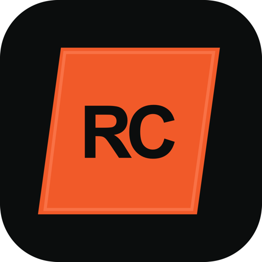

<div align="center">
  
  <h1>OpenRoughCut</h1>
  <p><strong>Turn a recording into an editable rough cut.</strong></p>
  <p>
    <a href="https://github.com/tomfordrumm/OpenRoughCut/releases/latest">Download</a> ·
    <a href="https://orc.yhub.net">Website</a> ·
    <a href="https://github.com/tomfordrumm/OpenRoughCut/releases">Releases</a> ·
    <a href="docs/USAGE.md">CLI &amp; development</a>
  </p>
  <p>
    <a href="https://github.com/tomfordrumm/OpenRoughCut/actions/workflows/checks.yml"></a>
  </p>
</div>

OpenRoughCut finds long pauses and repeated takes in a recording. Review the
suggested cuts, make your own edits, and export a timeline to Final Cut Pro,
Adobe Premiere Pro, or DaVinci Resolve. Analysis runs on your computer.

## What you can do

- **Cut pauses.** Set a silence threshold and decide how much of each pause to
  keep. Optionally detect isolated sighs, clicks, and other sounds between words.
- **Review repeated takes.** Transcribe with Whisper and compare attempts in the
  transcript. Keep a suggested cut, restore a region, or mark a cut yourself.
- **Play the rough cut.** Edited preview skips removed ranges. Save a
  `.roughcut` project to continue editing later.
- **Export.** Send an editable timeline to your editor, or render an H.264 MP4.

| Destination | Format |
| --- | --- |
| Final Cut Pro | FCPXML (`.fcpxml`) |
| Adobe Premiere Pro | Final Cut Pro 7 XML (`.xml`) |
| DaVinci Resolve 18.5+ | OpenTimelineIO (`.otio`) |
| Video file | H.264/AAC (`.mp4`) |

Timeline exports reference the original recording. In Final Cut Pro, the
import also includes a **Source** compound clip. Reframe the recording there
once to apply the change to all its cuts.

## Install

1. Open the [releases page](https://github.com/tomfordrumm/OpenRoughCut/releases)
   and choose a build for your computer.
2. On macOS, open the DMG for Apple Silicon (`arm64`) or Intel (`x64`) and drag
   OpenRoughCut into Applications. For Windows x64, run the EXE from a release
   that includes it.
3. Open the app and approve first-run setup. It downloads FFmpeg and FFprobe,
   the selected Whisper model, and the accompanying voice activity model.
   You need an internet connection for setup.

## Make your first cut

1. Open a recording and select **Analyse source**. Turn on **Find false starts
   and repeated takes** if you want transcript-based suggestions.
2. Inspect the marked ranges on the timeline. Use **Edited preview** to hear
   how the joins sound, then restore or remove ranges as needed.
3. Save the project, choose an export format, and open the result in your editor.

## Privacy

Media analysis and transcription run locally. OpenRoughCut leaves your source
file intact and creates a local playback proxy. Project files store the
source path and edit decisions. Logs can include local paths and system
details, so review them before sharing.

## Build and test

Use Node.js 24.17.0 to match the release build.

```sh
npm ci
npm test
npm run app
```

- [CLI usage, project workflow, and repository layout](docs/USAGE.md)
- [Packaging, signing, and release verification](docs/RELEASING.md)

## License

OpenRoughCut's own code is available under the [MIT License](LICENSE).
Third-party components are distributed under their respective licenses. See the
[bundled notices](apps/desktop/build/THIRD-PARTY-NOTICES.txt) and
[runtime inventory](docs/RELEASING.md#runtime-layout).
